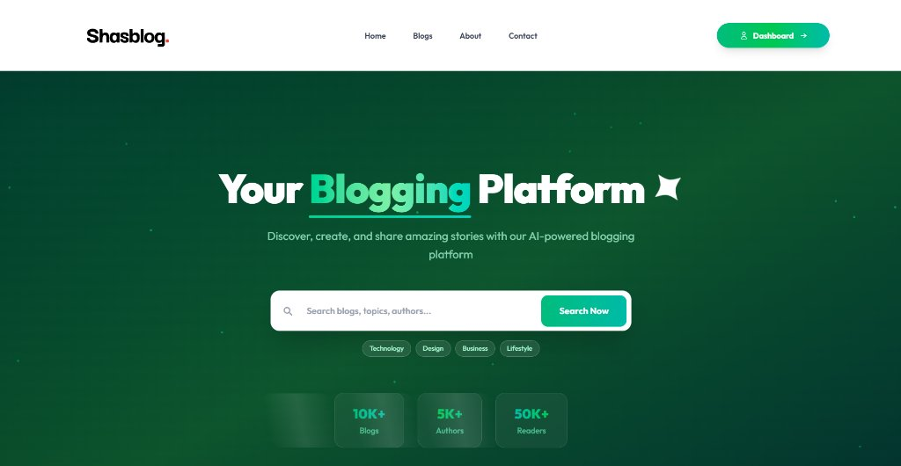
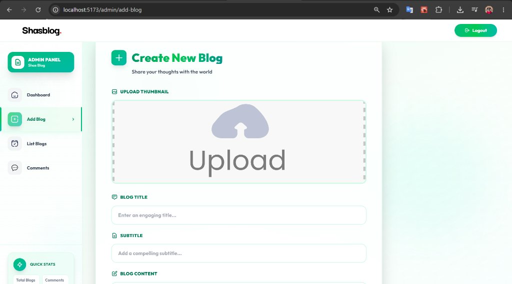

# 🚀 Shasblog — AI-Powered Full-Stack Blogging Platform

[](https://react.dev/)
[](https://nodejs.org/)
[](https://www.mongodb.com/)
[](https://tailwindcss.com/)
[](https://ai.google.dev/)
[](https://imagekit.io/)

**Shasblog** is a modern, high-performance full-stack blogging platform built with the MERN stack. It empowers creators to draft, generate, and publish engaging content seamlessly using **Google Gemini AI**, rich-text editing, and automated cloud media optimization.

---

## 📸 Screenshots

| 🌐 Public Home & Discovery |
| :---: |
|  |

| ✍️ Admin Panel — Create Blog with AI |
| :---: |
|  |

---

## ✨ Features

- **🤖 AI-Assisted Writing**: Integrate Google Gemini to automatically generate comprehensive blog posts, drafts, and outlines with a single click.
- **✍️ Rich Text & Markdown Editor**: Built-in **Quill editor** supporting full markdown parsing, heading styles, blockquotes, and custom formatting.
- **🖼️ Automated Media Optimization**: Upload thumbnails directly to **ImageKit** with automatic WebP conversion, dimension resizing, and CDN caching.
- **📊 Robust Admin Dashboard**:
  - Secure JWT authentication with bcrypt password hashing.
  - Real-time statistics on total blogs, active authors, and readers.
  - Post management: Add, edit, delete, and toggle publish/draft status.
  - Comment moderation workflow: approve or delete user comments.
- **🔍 Filter & Search**: Instant category-based browsing (`Technology`, `Startup`, `Lifestyle`, `Finance`) and keyword search.
- **⚡ Modern UI/UX**: Fluid page transitions and micro-animations crafted with **Framer Motion** and **Tailwind CSS v4**.

---

## 🛠️ Tech Stack

### **Frontend (`/client`)**
- **Framework:** React 19 + Vite
- **Styling:** Tailwind CSS v4
- **Animations:** Framer Motion
- **Editor:** Quill + Marked (Markdown parsing)
- **Routing & Notifications:** React Router DOM v7, React Hot Toast
- **HTTP Client:** Axios

### **Backend (`/server`)**
- **Runtime:** Node.js (ES Modules)
- **Framework:** Express 5
- **Database:** MongoDB Atlas via Mongoose 9
- **Authentication:** JSON Web Tokens (JWT) + bcryptjs
- **Media Storage:** ImageKit Node SDK + Multer (multipart upload handling)
- **AI Integration:** `@google/genai` (Google Gemini SDK)

---

## 📁 Project Structure

```text
Blog-App/
├── screenshots/             # Repository preview screenshots
│   ├── home.jpg
│   └── admin-create-blog.jpg
├── client/                  # Frontend Vite + React application
│   ├── src/
│   │   ├── assets/          # Icons, illustrations, dummy blog data
│   │   ├── components/      # Navbar, Header, Footer, Admin tables & forms
│   │   ├── context/         # React Context API (global state & Axios setup)
│   │   ├── pages/           # Home, Blog Details, Admin pages (Dashboard, Add, List, Comments)
│   │   ├── App.jsx
│   │   └── main.jsx
│   ├── index.html
│   └── package.json
├── server/                  # Backend Express REST API
│   ├── configs/             # MongoDB, ImageKit & Gemini configurations
│   ├── controllers/         # Admin & Blog business logic
│   ├── middleware/          # JWT auth & Multer upload middleware
│   ├── models/              # Mongoose schemas (Blog, User, Comment)
│   ├── routes/              # Express API route endpoints
│   ├── server.js            # Express application entry point
│   └── package.json
└── README.md
```

---

## ⚙️ Environment Variables

Create `.env` files in both the `server` and `client` directories:

### **1. Server (`server/.env`)**
```env
PORT=3000
MONGODB_URI=your_mongodb_connection_string
JWT_SECRET=your_jwt_secret_key

# Admin Credentials
ADMIN_EMAIL=your_admin_email@example.com
ADMIN_PASSWORD=your_admin_password

# ImageKit Configuration
IMAGEKIT_PUBLIC_KEY=your_imagekit_public_key
IMAGEKIT_PRIVATE_KEY=your_imagekit_private_key
IMAGEKIT_URL_ENDPOINT=https://ik.imagekit.io/your_endpoint

# Google Gemini API
GEMINI_API_KEY=your_google_gemini_api_key
```

### **2. Client (`client/.env`)**
```env
VITE_BASE_URL=http://localhost:3000
```

---

## 🚀 Getting Started

### Prerequisites
- [Node.js](https://nodejs.org/) (v18 or higher recommended)
- [MongoDB Atlas](https://www.mongodb.com/atlas) account or local MongoDB instance
- [ImageKit](https://imagekit.io/) account
- [Google AI Studio](https://aistudio.google.com/) Gemini API Key

---

### Installation & Local Setup

#### 1. Clone the repository
```bash
git clone https://github.com/your-username/Blog-App.git
cd Blog-App
```

#### 2. Start the Backend Server
```bash
cd server
npm install
npm run dev
```
The server will start on `http://localhost:3000`.

#### 3. Start the Frontend Application
Open a new terminal window:
```bash
cd client
npm install
npm run dev
```
The application will launch on `http://localhost:5173`.

---

## 📡 API Overview

| Method | Endpoint | Description | Auth Required |
| :--- | :--- | :--- | :---: |
| `POST` | `/api/admin/login` | Authenticate admin user | No |
| `GET` | `/api/admin/dashboard` | Fetch dashboard stats | Yes (JWT) |
| `GET` | `/api/admin/blogs` | Get all blogs (including unpublished) | Yes (JWT) |
| `GET` | `/api/blog` | Get all published blogs | No |
| `GET` | `/api/blog/:blogId` | Fetch single blog details | No |
| `POST` | `/api/blog/add` | Create a new blog post with image | Yes (JWT) |
| `POST` | `/api/blog/generateContent` | Generate content using Gemini AI | No |
| `POST` | `/api/blog/togglePublish/:id` | Toggle public visibility | Yes (JWT) |
| `DELETE`| `/api/blog/:blogId` | Delete a blog post | Yes (JWT) |
| `POST` | `/api/blog/addComment` | Post reader comment | No |
| `POST` | `/api/admin/approveComment` | Approve pending comment | Yes (JWT) |
| `POST` | `/api/admin/deleteComment` | Delete comment | Yes (JWT) |

---

## 🤝 Contributing

Contributions, issues, and feature requests are welcome! Feel free to check the [issues page](https://github.com/your-username/Blog-App/issues).

---

## 📝 License

This project is licensed under the **MIT License**.
